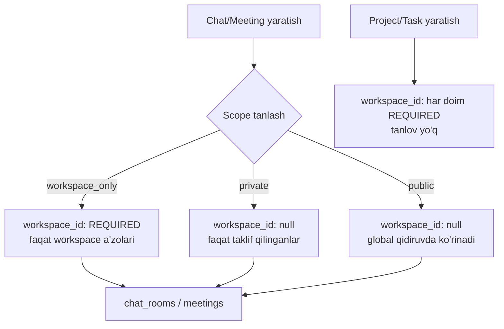

# UPZ (Universal Productivity Zone) — System Design

> Ushbu hujjat maqsad-spec (target) bilan hozirgi kod holatini solishtiradi, ayniqsa **workspace-optional** dizayn qarorini to'liq asoslaydi. Kod yozishdan oldingi reja hujjati — amalga oshirish tartibi 12-bo'limda.

Status belgilari: ✅ mavjud va spec'ga mos | ⚠️ mavjud, lekin farqli/qisman | ❌ umuman yo'q | 🔧 taklif (yangi qaror, hali yozilmagan)

---

## 1. Overview

UPZ — developer-centric collaboration platform. GitHub'ni almashtirmaydi, uning ustiga **intelligent collaboration layer** bo'lib ishlaydi: task management, team collaboration, realtime communication, developer analytics, push review system — bittasi ostida.

**Core goal**: developer workflow'ni buzmaslik. Developer oddiy `git add / commit / push` bilan ishlayveradi; UPZ orqa fonda kuzatadi, task'ga bog'laydi, review pipeline'ni boshqaradi.

## 2. Tech stack — spec vs hozirgi holat

| Qatlam | Spec | Hozirgi holat | Status |
|---|---|---|---|
| Backend | NestJS + TypeORM + PostgreSQL | NestJS ^11 + TypeORM `DataSource` (raw SQL) + PostgreSQL (Neon) | ✅ |
| Cache/Queue | Redis + BullMQ | Redis (Upstash) + BullMQ | ✅ |
| Realtime | Socket.IO + Redis Adapter | Socket.IO + `@socket.io/redis-adapter` | ✅ |
| **Frontend** | **Next.js** + TypeScript + Tailwind | **React 19 + Vite** + TypeScript, router: `wouter` | ⚠️ **Next.js emas** — qayta yozish katta xarajat, faqat yangi loyiha boshlansa mantiqiy. Hozirgi Vite+React stack'ni davom ettirish tavsiya etiladi, spec shu joyi yangilanishi kerak. |
| Storage | Cloudflare R2 / S3-compatible | R2/S3 (`@aws-sdk/client-s3`) + Cloudinary | ✅ |
| Git integratsiya | GitHub App + Webhooks + OAuth | GitHub App, webhook controller, OAuth (Passport) | ✅ |
| CLI | `npm install -g upz`, git hook injection | **Yo'q** | ❌ (14-bo'lim) |

## 3. Domain hierarchy va workspace-optional dizayn qarori

Bu bo'lim — foydalanuvchi so'ragan asosiy arxitektura qarori: **nima uchun barcha logikani workspace ustiga qurmaymiz**.

### 3.1 Muammo

Spec'dagi domain ierarxiyasi:
```
Platform → Workspace → Groups → Projects → Tasks
```
Bu **faqat Project/Task uchun to'g'ri**. Chat va Meeting bu ierarxiyaga qattiq bog'lansa, quyidagi holatlar ifodalab bo'lmaydi:
- Ikki foydalanuvchi orasidagi **shaxsiy DM** (workspace'siz, yoki turli workspace a'zolari orasida)
- **Ochiq (public) meeting** — istalgan foydalanuvchi qidirib topib qo'shilishi mumkin, workspace a'zosi bo'lmasa ham
- Workspace tashkil qilinmasdan turib tezkor meeting/chat yaratish (masalan, tashqi mijoz bilan)

Shuning uchun: **Project va Task uchun workspace har doim REQUIRED. Chat va Meeting uchun workspace OPTIONAL** — buning o'rniga, yaratish paytida foydalanuvchi **scope** tanlaydi.

### 3.2 Qaror: uch xil scope, foydalanuvchi create paytida tanlaydi

Chat xonasi yoki meeting yaratilganda, foydalanuvchi quyidagi 3 variantdan birini tanlaydi:

| Scope | `workspace_id` | Ko'rinuvchanlik | Qo'shilish |
|---|---|---|---|
| **`workspace_only`** | **required** | Faqat shu workspace a'zolariga | Workspace a'zoligi orqali avtomatik |
| **`private`** | optional (null bo'lishi mumkin) | Faqat aniq taklif qilingan foydalanuvchilarga | Faqat taklif/invite orqali |
| **`public`** | optional (null bo'lishi mumkin) | Global qidiruvda ko'rinadi, workspace a'zosi bo'lmasa ham | Istalgan ro'yxatdan o'tgan foydalanuvchi qo'shilishi mumkin |

Bu qoida **chat_rooms va meetings jadvallariga bir xilda qo'llanadi** — ikkalasi ham xuddi shu scope modelidan foydalanadi, chunki ikkalasi ham "workspace ichida yoki tashqarisida bo'lishi mumkin bo'lgan realtime hamkorlik joyi" degan bir xil tabiatga ega.

**Project va Task uchun bunday tanlov yo'q** — `workspace_id` doim `NOT NULL`, chunki ular strukturaviy jihatdan `Workspace → Group → Project → Task` ierarxiyasining ajralmas qismi (kolonka, kanban board, workspace-darajasidagi analytics — bularning barchasi workspace kontekstisiz ma'nosiz).

### 3.3 Hozirgi kod holati — yaxshi xabar

Tekshiruv shuni ko'rsatdiki, **DB darajasida bu qaror qisman allaqachon amalga oshirilgan**:

- ✅ `chat_rooms.workspace_id` — nullable (`1783900000000-DecoupleChatMeetingsAddNotes` migratsiyasi orqali)
- ✅ `meetings.workspace_id` — nullable (xuddi shu migratsiya)
- ✅ `projects.workspace_id`, `tasks.workspace_id` — `NOT NULL` (o'zgarmagan, to'g'ri)

**Lekin scope/visibility modeli chalkash va tarqoq holatda**:

| Enum | Joylashuvi | Qiymatlar | Muammo |
|---|---|---|---|
| `ChatVisibility` | `chat.entity` | `public, invite_only, workspace_only, members_only` | 4 qiymat, spec'dagi 3 tadan ko'p, "invite_only" va "members_only" farqi noaniq |
| `MeetingVisibility` | `meeting.entity` | `public, workspace, private, selected_users` | Chat bilan boshqa nomlanish (`workspace` vs `workspace_only`, `selected_users` vs `private`) |
| `WorkspaceVisibility` | `workspace.entity` | `public, private` | Workspace'ning o'zi haqida, bu bo'limga aloqasi yo'q |
| `ProjectVisibility` | `project.entity` | `public, workspace, private` | Loyihaga aloqasi yo'q, workspace ichidagi ko'rinuvchanlik |
| `ChatRoomType` | `chat.entity` | `public, private, workspace, project, group, direct` | **Ikki tushunchani aralashtirib yuboradi**: "xona qanday turdan" (workspace/group/project/direct — strukturaviy) va "kim ko'ra oladi" (public/private — visibility) bir enum ichida |

Bu — aynan foydalanuvchi ta'kidlagan "logikani oldindan puxta o'ylab olish kerak" degan nuqta. To'rtta turli visibility enum bir xil tushunchani turlicha ifodalaydi — yangi funksiya qo'shilganda yana biri paydo bo'lishi tabiiy.

### 3.4 Konsolidatsiya — ✅ amalga oshirildi



**Yangi yagona enum**: `RoomScope` (yoki `CollabScope`) — `chat` va `meeting` uchun umumiy:
```ts
export enum RoomScope {
  WORKSPACE_ONLY = 'workspace_only',
  PRIVATE = 'private',
  PUBLIC = 'public',
}
```

- `chat_rooms.type` (strukturaviy: workspace/group/project/direct) **saqlanib qoladi** — bu "xona nima ustida" degan savolga javob beradi (allaqachon to'g'irlandi, server tomonida `group_id`/`project_id`/`targetUserId`dan hosila qilinadi).
- `ChatVisibility` va `MeetingVisibility` — ikkalasi ham `RoomScope`ga almashtiriladi (bitta enum, ikkala jadvalda ham ishlatiladi).
- `WorkspaceVisibility` va `ProjectVisibility` — **tegilmaydi**, ular boshqa kontekst (workspace/project o'zining ko'rinuvchanligi, bu bo'limdagi muammoga aloqasi yo'q).
- Validatsiya qoidasi (servis darajasida, DB constraint emas — chunki PostgreSQL CHECK constraint bilan "agar scope=workspace_only bo'lsa, workspace_id NOT NULL" qoidasini yozish mumkin, lekin bu ishga migratsiya bosqichida alohida qaraladi): `scope === WORKSPACE_ONLY` bo'lsa `workspace_id` majburiy, aks holda ixtiyoriy.

**Amalga oshirildi** ([1784300000000-ConsolidateRoomScope.ts](backend/src/database/migrations/1784300000000-ConsolidateRoomScope.ts)):
- `RoomScope` enum qo'shildi ([common/enums/index.ts](backend/src/common/enums/index.ts)), `ChatVisibility`/`MeetingVisibility` o'chirildi.
- `ChatRoomType`dan `PUBLIC`/`PRIVATE` qiymatlari olib tashlandi (ular hech qayerda ishlatilmagan edi) — endi faqat strukturaviy qiymatlar: `workspace/project/group/direct`.
- `chat_rooms.visibility` va `meetings.visibility` ustunlari `scope`ga almashtirildi, mavjud qiymatlar xavfsiz backfill qilindi (`chat_rooms`: 24 ta `workspace_only`, 1 ta `private`; `meetings`: 35 ta `private`).
- Ikkala jadvalga ham CHECK constraint qo'shildi: `scope != 'workspace_only' OR workspace_id IS NOT NULL`.
- `room.service.ts::createRoom` va `meetings.service.ts::create` endi `workspaceId: string | null` qabul qiladi, `scope`ga qarab validatsiya qiladi (`WORKSPACE_ONLY` bo'lsa workspace majburiy, aks holda ixtiyoriy).
- Yangi endpoint: `POST chat/rooms` (workspace'siz, standalone xona yaratish) — meetings'dagi `POST meetings` pattern'iga mos.
- Yon-ta'sir sifatida tuzatilgan bug: `room.visibility` kodda o'qilardi, lekin SQL'da umuman SELECT qilinmagan edi (har doim `undefined` qaytargan) — endi `scope` to'g'ri select qilinadi.

## 4. Role va Group Type tizimi

✅ **To'liq mos** — hech qanday farq yo'q.

- `WorkspaceRole`: `owner, admin, lead, senior, middle, junior, guest` — mos.
- `GroupType`: `general, development, design, marketing, management, qa, devops, hr, product` — mos.

## 5. Database arxitekturasi — spec vs hozirgi

45 ta entity mavjud, spec'dagi deyarli barcha jadvallar bor. Farqlar:

| Spec jadvali | Holat |
|---|---|
| `users`, `user_settings`, `github_accounts`, `workspaces`, `workspace_members`, `groups`, `group_members`, `repositories`, `projects`, `project_columns`, `tasks`, `task_activities`, `task_pushes`, `chat_rooms`, `chat_members`, `chat_messages`, `chat_reactions`, `notifications`, `workspace_github_installations` | ✅ barchasi mavjud |
| `developer_project_stats` | ✅ mavjud, qo'shimcha `developer_daily_stats` ham bor (kunlik granulyarlik uchun) |
| — | ➕ Spec'da yo'q, lekin mavjud: `meetings` + `meeting_participants` + `meeting_recordings`, `notes`, `earnings`, `push_review_comments`, `task_dependencies`, `task_watchers`, `task_tags`, `chat_room_invites`, `workspace_invitations`, `notification_delivery_log`, `refresh_tokens`, `audit_log`, `banned_content`, `user_violations` — bularning barchasi spec'dan keyingi bosqichlarda tabiiy ravishda qo'shilgan, olib tashlash shart emas. |

**Soft delete siyosati** (9-bo'lim spec'da): ✅ core jadvallarda (`users`, `workspaces`, `groups`, `projects`, `tasks`) `deleted_at`/`deleted_by` mavjud.

## 6. Push Review System — spec vs hozirgi

| Komponent | Holat |
|---|---|
| Push submit (diff bundle → R2/S3) | ✅ `StorageService` orqali |
| Push type resolution (`github_direct`/`upz_review`/`draft`) | ✅ rol asosida |
| Lead/admin approve-reject | ✅ `PermissionService.assertCanReviewPush/assertCanApprovePush` |
| Review comments (inline, resolve) | ✅ `push_review_comments` |
| Artifact expiry (7-14 kun) | ✅ `PUSH_ARTIFACT_TTL_DAYS`, `artifact-cleanup.processor.ts` (BullMQ) |
| Approve → GitHub PR yaratish → webhook → analytics update | ⚠️ tekshirish kerak — GitHub API orqali PR yaratish qismi mavjudligi alohida tasdiqlanishi kerak |

**Xulosa**: server-tomonidagi review pipeline **~60-70% tayyor**. Yetishmayotgan qism — mijoz tomoni (14-bo'lim, CLI).

## 7. CLI tizimi — ❌ umuman yo'q

Spec'ning 12-bo'limi (`npm install -g upz`, `upz login`, git hook injection, pre-push flow, branch'dan `UPZ-123` parse qilish) — **repo ichida hech qanday izi yo'q**. Bu alohida paket/loyiha bo'lishi kerak (masalan `packages/cli` yoki alohida repo), backend bilan faqat REST/OAuth orqali gaplashadi.

**Nima kerak (kelajakdagi ish, hozir yozilmaydi)**:
1. Alohida Node.js CLI paketi (`upz` binary, `commander`/`oclif` asosida).
2. `upz login` — mahalliy portda vaqtinchalik server ochib, brauzerda OAuth qiladi, keyin tokenni `~/.upz/credentials`ga saqlaydi (xuddi `gh auth login` kabi).
3. `upz init` (yoki avtomatik birinchi push'da) — `.git/hooks/pre-push` ichiga UPZ hook skriptini inject qiladi.
4. Hook: joriy branch nomini o'qiydi (`feature/UPZ-123-auth` → `UPZ-123`), backend'dan mos taskni topadi (`GET /tasks?externalRef=UPZ-123`), workspace/project qoidalariga qarab (`github_direct` yoki `upz_review`) push turini aniqlaydi, kerak bo'lsa diff'ni backend'ga yuboradi.
5. Backend tomonida buning uchun kerakli endpoint'lar (`task lookup by branch ref`) allaqachon mavjud infratuzilma ustiga qurilishi mumkin — yangi endpoint kerak bo'lishi ehtimoli bor.

## 8. WebSocket — nomlash konvensiyasi farqi

| | Spec | Hozirgi |
|---|---|---|
| Xona nomlari | `workspace:{id}`, `group:{id}`, `project:{id}`, `chat:{id}` | `user:{userId}`, `workspace:{workspaceId}`, `room:{chatRoomId}`, `meeting:{meetingId}` |
| Event nomlari | dot-notation: `task.created`, `message.created`, `notification.created`, `github.push`, `user.online` | snake_case/colon: `new_message`, `notification`, `user_online`, `typing`, `meeting:offer` va h.k. |

⚠️ **Bu farq spec'ni yangilashni talab qiladi, kodni emas** — mavjud konvensiya (snake_case events, `room:{id}` chat uchun) allaqachon frontend bilan ishlab turibdi ([events.gateway.ts](backend/src/modules/gateway/events.gateway.ts)). Nomlash konvensiyasini spec'ga moslab qayta yozish katta, foydasiz refaktor bo'lardi — **spec shu joyda amaliyotga moslashtirilishi tavsiya etiladi**. Yetishmayotgan narsa: `task.created/updated/moved` kabi task-board realtime broadcast eventlari — bular hozircha gateway'da yo'q, Kanban board'da drag-drop paytida boshqa foydalanuvchilarga realtime yangilanish ko'rinmaydi.

## 9. Queue tizimi — spec vs hozirgi

| Spec | Hozirgi | Status |
|---|---|---|
| `github-webhooks` | Yo'q — webhook sinxron ishlanadi (`github.service.ts`) | ❌ agar webhook hajmi ortsa, kelajakda navbatga o'tkazish kerak bo'ladi |
| `push-analysis` | Yo'q | ❌ |
| `artifact-cleanup` | ✅ `ARTIFACT_CLEANUP_QUEUE` | ✅ |
| `notifications` | ✅ `REMINDER_QUEUE` (o'xshash vazifa) | ✅ ekvivalent |
| `analytics` | Yo'q | ❌ |
| `emails` | Yo'q — sinxron SMTP | ❌ (allaqachon bir marta muhokama qilingan: invite email'lar `void`, fire-and-forget qilib yuborilgan — navbatga o'tkazish tavsiya etiladi) |

Qo'shimcha mavjud (spec'da yo'q): `auth` queue, `chat` queue, `MEETING_RECORDING_QUEUE`.

## 10. i18n / xato formatlash

| | Spec | Hozirgi |
|---|---|---|
| Format | `{success:false, error:{code, message: "errors.task_not_found"}}` (i18n kalit) | `{success:false, ...}` + `code: 'TASK_NOT_FOUND'` + **literal inglizcha matn** (`message: 'Task not found'`) |
| Locale saqlash | — | ✅ `UserLanguage` enum (`uz/ru/en`) va `users.language` ustuni mavjud, lekin xato javoblariga ulanmagan |

⚠️ Bu — oldingi suhbatda ko'rgan muammoning tizimli ko'rinishi (`ALREADY_MEMBER` xabari inglizcha chiqqani). Hozircha frontend darajasida nuqtama-nuqta (`code`ga qarab) tarjima qilindi. **Tizimli yechim** (hozircha amalga oshirilmagan, faqat qayd etilyapti): backend barcha `throw new XException({code, message})`dagi `message`ni statik inglizcha matn emas, balki i18n kalit (`errors.task_not_found`) qilib yuborishi, frontend esa `code`/`message` kaliti orqali `uz/ru/en` tarjima jadvalidan matn olishi kerak. Bu — ko'p fayl (barcha `throw new *Exception` joylari, ~100+ o'rinlar) qamrab oladigan katta refaktor, alohida bosqich sifatida rejalashtiriladi.

## 11. Xavfsizlik — spec vs hozirgi

✅ Deyarli to'liq mos: JWT + refresh token, rate limiting, GitHub signature verification, RBAC (`PermissionService`), encrypted GitHub tokens (`ENCRYPTION_KEY`). Bitta o'tgan safar topilgan va tuzatilgan zaiflik: Redis fail-closed → fail-open (blacklist tekshiruvi Redis o'chsa endi foydalanuvchilarni bloklamaydi).

## 12. Gap Analysis — xulosa jadvali

| Bo'lim | Holat | Ustuvorlik |
|---|---|---|
| Core domain (workspace/group/project/task) | ✅ to'liq | — |
| Chat/Meeting workspace-optional + scope konsolidatsiyasi | ✅ to'liq amalga oshirildi | — |
| Push review pipeline (server) | ✅ 60-70% | O'rta |
| CLI + git hooks | ❌ 0% | Past (alohida loyiha, MVP'dan tashqarida bo'lishi mumkin) |
| WebSocket task-board eventlari | ❌ yo'q | O'rta — Kanban realtime uchun kerak |
| Queue: analytics/email/webhook | ❌ yo'q (sinxron ishlaydi) | Past — hozircha hajm kichik, muammo yo'q |
| i18n xato xabarlari | ⚠️ infratuzilma bor, ulanmagan | O'rta — foydalanuvchi tajribasiga bevosita ta'sir qiladi |
| Frontend: Next.js | ⚠️ spec eskirgan, kod React+Vite | — spec yangilanishi kerak |

## 13. Tavsiya qilinadigan navbat (keyingi qadamlar)

1. ~~`RoomScope` enum konsolidatsiyasi~~ — ✅ bajarildi (3.4-bo'lim).
2. **Public scope uchun global qidiruv endpoint'i** — hozircha `public` xona/meeting'larni workspace'siz qidirish imkoniyati yo'q (`listPublicRooms` hali workspace-scoped), buni ta'minlaydigan endpoint kerak. **Navbatdagi qadam.**
3. Task-board realtime eventlari (`task.moved` va h.k.) gateway'ga qo'shish.
4. i18n xato xabarlari — bosqichma-bosqich, birinchi navbatda eng ko'p uchraydigan xatolardan boshlab.
5. CLI — alohida loyiha sifatida keyinroq.

---

*Ushbu hujjat 2026-07-15 holatiga ko'ra tuzildi. Har bir bosqich amalga oshirilishidan oldin foydalanuvchi bilan alohida tasdiqlanadi.*
