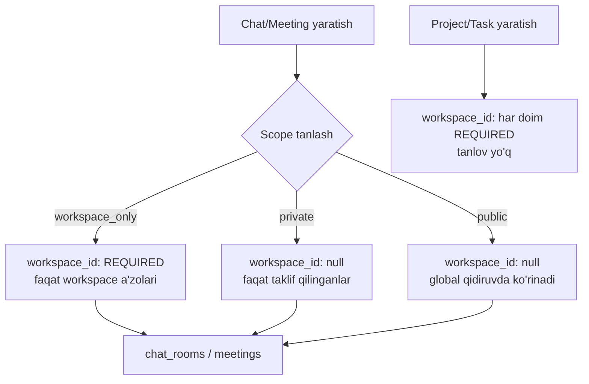

# UPZ (Universal Productivity Zone) — System Design

> Ushbu hujjat maqsad-spec (target) bilan hozirgi kod holatini solishtiradi, ayniqsa **workspace-optional** dizayn qarorini to'liq asoslaydi. Kod yozishdan oldingi reja hujjati — amalga oshirish tartibi 12-bo'limda.

Status belgilari: ✅ mavjud va spec'ga mos | ⚠️ mavjud, lekin farqli/qisman | ❌ umuman yo'q | 🔧 taklif (yangi qaror, hali yozilmagan)

---

## 1. Overview

UPZ — developer-centric collaboration platform. GitHub'ni almashtirmaydi, uning ustiga **intelligent collaboration layer** bo'lib ishlaydi: task management, team collaboration, realtime communication, developer analytics, push review system — bittasi ostida.

**Core goal**: developer workflow'ni buzmaslik. Developer oddiy `git add / commit / push` bilan ishlayveradi; UPZ orqa fonda kuzatadi, task'ga bog'laydi, review pipeline'ni boshqaradi.

## 2. Tech stack — spec vs hozirgi holat

| Qatlam | Spec | Hozirgi holat | Status |
|---|---|---|---|
| Backend | NestJS + TypeORM + PostgreSQL | NestJS ^11 + plain `pg.Pool` (raw SQL, no ORM) + PostgreSQL | ⚠️ TypeORM to'liq olib tashlandi 2026-07-16 — pastga qarang |
| Cache/Queue | Redis + BullMQ | Redis (Upstash) + BullMQ | ✅ |
| Realtime | Socket.IO + Redis Adapter | Socket.IO + `@socket.io/redis-adapter` | ✅ |
| **Frontend** | **Next.js** + TypeScript + Tailwind | **React 19 + Vite** + TypeScript, router: `wouter` | ⚠️ **Next.js emas** — qayta yozish katta xarajat, faqat yangi loyiha boshlansa mantiqiy. Hozirgi Vite+React stack'ni davom ettirish tavsiya etiladi, spec shu joyi yangilanishi kerak. |
| Storage | Cloudflare R2 / S3-compatible | R2/S3 (`@aws-sdk/client-s3`) + Cloudinary | ✅ |
| Git integratsiya | GitHub App + Webhooks + OAuth | GitHub App, webhook controller, OAuth (Passport) | ✅ |
| CLI | `npm install -g upz`, git hook injection | **Yo'q** | ❌ (14-bo'lim) |

### 2.1 TypeORM'dan to'liq voz kechish (2026-07-16)

Loyiha allaqachon 100% raw SQL bilan ishlagani uchun (TypeORM faqat connection pool va migration runner sifatida ishlatilardi), TypeORM butunlay olib tashlandi:

- **`DataSource` → `DatabaseService`** ([database/database.service.ts](backend/src/database/database.service.ts)) — plain `pg.Pool`ni o'raydigan yengil servis, `dataSource.query(sql, params)` bilan **bir xil signatura va qaytish shakli** (tekis massiv), shuning uchun ~36 fayldagi barcha SQL chaqiruvlar o'zgarmadi — faqat inject qilinadigan tur o'zgardi.
- **Tranzaksiyalar** — `queryRunner.connect()/startTransaction()/commit/rollback/release` o'rniga `dataSource.withTransaction(async (query) => {...})` — avtomatik commit/rollback/release. 9 ta joyda qo'llanildi (workspace/project/task/group yaratish, invitation qabul qilish, ownership transfer, violation tracking).
- **45 ta entity** — decorator'li TypeORM class'laridan (`@Entity`, `@Column` va h.k.) oddiy TypeScript interfeyslariga aylantirildi — hali ham SQL natijalarini tiplashda ishlatiladi, lekin runtime'da hech qanday ORM metadata yo'q.
- **30+ migratsiya fayli o'chirildi**, o'rniga bitta [backend/docker/postgres/init.sql](backend/docker/postgres/init.sql) — joriy to'liq schema'ning bir martalik dump'i. **Kelajakda schema o'zgarishi kerak bo'lsa, shu faylni qo'lda tahrirlash kerak** — versiyalangan migration tizimi endi yo'q. Bu tezkorlik uchun ongli tanlov, ammo katta jamoa/production uchun xavf-foyda nisbatini alohida baholash tavsiya etiladi.
- **Ikki xil docker-compose**: [docker-compose.yml](docker-compose.yml) (ildizda, production-uslub, multi-stage build, to'liq stack: postgres+redis+coturn+backend+frontend) va [backend/docker-compose.yaml](backend/docker-compose.yaml) (backend ichida, dev-uslub, bind-mount + `npm run dev`, faqat backend+postgres+redis).

### 2.2 Modul strukturasini qayta qurish: controllers/services/repositories/schemas (2026-07-16, davom etmoqda)

Har bir modul quyidagi ichki strukturaga o'tkazilmoqda: `controllers/`, `services/`, `repositories/` (SQL shu yerda, service faqat biznes-logika), `schemas/` (Zod, `class-validator`ning o'rnida), `guards/`, `strategies/`.

**Holat**: `auth`, `users`, `workspaces`, `groups` — to'liq o'tkazildi va end-to-end tekshirildi (register→login→workspace→group). Global validatsiya `nestjs-zod`ning `ZodValidationPipe`siga o'tkazildi ([validation.bootstrap.ts](backend/src/bootstrap/validation.bootstrap.ts)), xato formatlash Zod issue'larini `VALIDATION_ERROR` kodiga moslab qaytaradi ([all-exceptions.filter.ts](backend/src/common/filters/all-exceptions.filter.ts)).

**Qolgan modullar** (hali eski strukturada, `class-validator` bilan): `projects`, `tasks`, `chat`, `meetings`, `notifications`, `github`, `storage`, `analytics`, `moderation`, `earnings`, `notes`, `pushes`, `gateway` — jami ~11 000 qator. Bu modullar ishlab turibdi (typecheck toza, runtime test o'tgan), faqat eski (`dto/` + class-validator, SQL service ichida) strukturada qolgan.

**Loyiha vaqtincha i

kki xil DTO konvensiyasini parallel qo'llab-quvvatlaydi** (Zod — yangi 4 modul, class-validator — qolgan 13 modul). Buni xavfsiz qilish uchun [validation.bootstrap.ts](backend/src/bootstrap/validation.bootstrap.ts)da **`DualValidationPipe`** yozildi — har bir DTO uchun `metatype.isZodDto` belgisiga qarab kerakli pipe'ga yo'naltiradi. (Birinchi urinish — ikkala pipe'ni ketma-ket ishlatish — xato edi: class-validator'ning `whitelist:true` Zod DTO'larning BARCHA maydonlarini "notanish" deb hisoblab, so'rovni butunlay rad etardi; darhol topilib, to'g'irlandi va ikkala turdagi endpoint alohida-alohida qayta tekshirildi.) Loyiha barcha modullar Zod'ga o'tkazilgach, bu vaqtinchalik pipe olib tashlanishi va `class-validator`/`class-transformer` paketlari butunlay o'chirilishi kerak.

## 3. Domain hierarchy va workspace-optional dizayn qarori

Bu bo'lim — foydalanuvchi so'ragan asosiy arxitektura qarori: **nima uchun barcha logikani workspace ustiga qurmaymiz**.

### 3.1 Muammo

Spec'dagi domain ierarxiyasi:
```
Platform → Workspace → Groups → Projects → Tasks
```
Bu **faqat Project/Task uchun to'g'ri**. Chat va Meeting bu ierarxiyaga qattiq bog'lansa, quyidagi holatlar ifodalab bo'lmaydi:
- Ikki foydalanuvchi orasidagi **shaxsiy DM** (workspace'siz, yoki turli workspace a'zolari orasida)
- **Ochiq (public) meeting** — istalgan foydalanuvchi qidirib topib qo'shilishi mumkin, workspace a'zosi bo'lmasa ham
- Workspace tashkil qilinmasdan turib tezkor meeting/chat yaratish (masalan, tashqi mijoz bilan)

Shuning uchun: **Project va Task uchun workspace har doim REQUIRED. Chat va Meeting uchun workspace OPTIONAL** — buning o'rniga, yaratish paytida foydalanuvchi **scope** tanlaydi.

### 3.2 Qaror: uch xil scope, foydalanuvchi create paytida tanlaydi

Chat xonasi yoki meeting yaratilganda, foydalanuvchi quyidagi 3 variantdan birini tanlaydi:

| Scope | `workspace_id` | Ko'rinuvchanlik | Qo'shilish |
|---|---|---|---|
| **`workspace_only`** | **required** | Faqat shu workspace a'zolariga | Workspace a'zoligi orqali avtomatik |
| **`private`** | optional (null bo'lishi mumkin) | Faqat aniq taklif qilingan foydalanuvchilarga | Faqat taklif/invite orqali |
| **`public`** | optional (null bo'lishi mumkin) | Global qidiruvda ko'rinadi, workspace a'zosi bo'lmasa ham | Istalgan ro'yxatdan o'tgan foydalanuvchi qo'shilishi mumkin |

Bu qoida **chat_rooms va meetings jadvallariga bir xilda qo'llanadi** — ikkalasi ham xuddi shu scope modelidan foydalanadi, chunki ikkalasi ham "workspace ichida yoki tashqarisida bo'lishi mumkin bo'lgan realtime hamkorlik joyi" degan bir xil tabiatga ega.

**Project va Task uchun bunday tanlov yo'q** — `workspace_id` doim `NOT NULL`, chunki ular strukturaviy jihatdan `Workspace → Group → Project → Task` ierarxiyasining ajralmas qismi (kolonka, kanban board, workspace-darajasidagi analytics — bularning barchasi workspace kontekstisiz ma'nosiz).

### 3.3 Hozirgi kod holati — yaxshi xabar

Tekshiruv shuni ko'rsatdiki, **DB darajasida bu qaror qisman allaqachon amalga oshirilgan**:

- ✅ `chat_rooms.workspace_id` — nullable (`1783900000000-DecoupleChatMeetingsAddNotes` migratsiyasi orqali)
- ✅ `meetings.workspace_id` — nullable (xuddi shu migratsiya)
- ✅ `projects.workspace_id`, `tasks.workspace_id` — `NOT NULL` (o'zgarmagan, to'g'ri)

**Lekin scope/visibility modeli chalkash va tarqoq holatda**:

| Enum | Joylashuvi | Qiymatlar | Muammo |
|---|---|---|---|
| `ChatVisibility` | `chat.entity` | `public, invite_only, workspace_only, members_only` | 4 qiymat, spec'dagi 3 tadan ko'p, "invite_only" va "members_only" farqi noaniq |
| `MeetingVisibility` | `meeting.entity` | `public, workspace, private, selected_users` | Chat bilan boshqa nomlanish (`workspace` vs `workspace_only`, `selected_users` vs `private`) |
| `WorkspaceVisibility` | `workspace.entity` | `public, private` | Workspace'ning o'zi haqida, bu bo'limga aloqasi yo'q |
| `ProjectVisibility` | `project.entity` | `public, workspace, private` | Loyihaga aloqasi yo'q, workspace ichidagi ko'rinuvchanlik |
| `ChatRoomType` | `chat.entity` | `public, private, workspace, project, group, direct` | **Ikki tushunchani aralashtirib yuboradi**: "xona qanday turdan" (workspace/group/project/direct — strukturaviy) va "kim ko'ra oladi" (public/private — visibility) bir enum ichida |

Bu — aynan foydalanuvchi ta'kidlagan "logikani oldindan puxta o'ylab olish kerak" degan nuqta. To'rtta turli visibility enum bir xil tushunchani turlicha ifodalaydi — yangi funksiya qo'shilganda yana biri paydo bo'lishi tabiiy.

### 3.4 Konsolidatsiya — ✅ amalga oshirildi



**Yangi yagona enum**: `RoomScope` (yoki `CollabScope`) — `chat` va `meeting` uchun umumiy:
```ts
export enum RoomScope {
  WORKSPACE_ONLY = 'workspace_only',
  PRIVATE = 'private',
  PUBLIC = 'public',
}
```

- `chat_rooms.type` (strukturaviy: workspace/group/project/direct) **saqlanib qoladi** — bu "xona nima ustida" degan savolga javob beradi (allaqachon to'g'irlandi, server tomonida `group_id`/`project_id`/`targetUserId`dan hosila qilinadi).
- `ChatVisibility` va `MeetingVisibility` — ikkalasi ham `RoomScope`ga almashtiriladi (bitta enum, ikkala jadvalda ham ishlatiladi).
- `WorkspaceVisibility` va `ProjectVisibility` — **tegilmaydi**, ular boshqa kontekst (workspace/project o'zining ko'rinuvchanligi, bu bo'limdagi muammoga aloqasi yo'q).
- Validatsiya qoidasi (servis darajasida, DB constraint emas — chunki PostgreSQL CHECK constraint bilan "agar scope=workspace_only bo'lsa, workspace_id NOT NULL" qoidasini yozish mumkin, lekin bu ishga migratsiya bosqichida alohida qaraladi): `scope === WORKSPACE_ONLY` bo'lsa `workspace_id` majburiy, aks holda ixtiyoriy.

**Amalga oshirildi** ([1784300000000-ConsolidateRoomScope.ts](backend/src/database/migrations/1784300000000-ConsolidateRoomScope.ts)):
- `RoomScope` enum qo'shildi ([common/enums/index.ts](backend/src/common/enums/index.ts)), `ChatVisibility`/`MeetingVisibility` o'chirildi.
- `ChatRoomType`dan `PUBLIC`/`PRIVATE` qiymatlari olib tashlandi (ular hech qayerda ishlatilmagan edi) — endi faqat strukturaviy qiymatlar: `workspace/project/group/direct`.
- `chat_rooms.visibility` va `meetings.visibility` ustunlari `scope`ga almashtirildi, mavjud qiymatlar xavfsiz backfill qilindi (`chat_rooms`: 24 ta `workspace_only`, 1 ta `private`; `meetings`: 35 ta `private`).
- Ikkala jadvalga ham CHECK constraint qo'shildi: `scope != 'workspace_only' OR workspace_id IS NOT NULL`.
- `room.service.ts::createRoom` va `meetings.service.ts::create` endi `workspaceId: string | null` qabul qiladi, `scope`ga qarab validatsiya qiladi (`WORKSPACE_ONLY` bo'lsa workspace majburiy, aks holda ixtiyoriy).
- Yangi endpoint: `POST chat/rooms` (workspace'siz, standalone xona yaratish) — meetings'dagi `POST meetings` pattern'iga mos.
- Yon-ta'sir sifatida tuzatilgan bug: `room.visibility` kodda o'qilardi, lekin SQL'da umuman SELECT qilinmagan edi (har doim `undefined` qaytargan) — endi `scope` to'g'ri select qilinadi.

## 4. Role va Group Type tizimi

✅ **To'liq mos** — hech qanday farq yo'q.

- `WorkspaceRole`: `owner, admin, lead, senior, middle, junior, guest` — mos.
- `GroupType`: `general, development, design, marketing, management, qa, devops, hr, product` — mos.

## 5. Database arxitekturasi — spec vs hozirgi

45 ta entity mavjud, spec'dagi deyarli barcha jadvallar bor. Farqlar:

| Spec jadvali | Holat |
|---|---|
| `users`, `user_settings`, `github_accounts`, `workspaces`, `workspace_members`, `groups`, `group_members`, `repositories`, `projects`, `project_columns`, `tasks`, `task_activities`, `task_pushes`, `chat_rooms`, `chat_members`, `chat_messages`, `chat_reactions`, `notifications`, `workspace_github_installations` | ✅ barchasi mavjud |
| `developer_project_stats` | ✅ mavjud, qo'shimcha `developer_daily_stats` ham bor (kunlik granulyarlik uchun) |
| — | ➕ Spec'da yo'q, lekin mavjud: `meetings` + `meeting_participants` + `meeting_recordings`, `notes`, `earnings`, `push_review_comments`, `task_dependencies`, `task_watchers`, `task_tags`, `chat_room_invites`, `workspace_invitations`, `notification_delivery_log`, `refresh_tokens`, `audit_log`, `banned_content`, `user_violations` — bularning barchasi spec'dan keyingi bosqichlarda tabiiy ravishda qo'shilgan, olib tashlash shart emas. |

**Soft delete siyosati** (9-bo'lim spec'da): ✅ core jadvallarda (`users`, `workspaces`, `groups`, `projects`, `tasks`) `deleted_at`/`deleted_by` mavjud.

## 6. Push Review System — spec vs hozirgi

| Komponent | Holat |
|---|---|
| Push submit (diff bundle → R2/S3) | ✅ `StorageService` orqali |
| Push type resolution (`github_direct`/`upz_review`/`draft`) | ✅ rol asosida |
| Lead/admin approve-reject | ✅ `PermissionService.assertCanReviewPush/assertCanApprovePush` |
| Review comments (inline, resolve) | ✅ `push_review_comments` |
| Artifact expiry (7-14 kun) | ✅ `PUSH_ARTIFACT_TTL_DAYS`, `artifact-cleanup.processor.ts` (BullMQ) |
| Approve → GitHub PR yaratish → webhook → analytics update | ⚠️ tekshirish kerak — GitHub API orqali PR yaratish qismi mavjudligi alohida tasdiqlanishi kerak |

**Xulosa**: server-tomonidagi review pipeline **~60-70% tayyor**. Yetishmayotgan qism — mijoz tomoni (14-bo'lim, CLI).

## 7. CLI tizimi — ❌ umuman yo'q

Spec'ning 12-bo'limi (`npm install -g upz`, `upz login`, git hook injection, pre-push flow, branch'dan `UPZ-123` parse qilish) — **repo ichida hech qanday izi yo'q**. Bu alohida paket/loyiha bo'lishi kerak (masalan `packages/cli` yoki alohida repo), backend bilan faqat REST/OAuth orqali gaplashadi.

**Nima kerak (kelajakdagi ish, hozir yozilmaydi)**:
1. Alohida Node.js CLI paketi (`upz` binary, `commander`/`oclif` asosida).
2. `upz login` — mahalliy portda vaqtinchalik server ochib, brauzerda OAuth qiladi, keyin tokenni `~/.upz/credentials`ga saqlaydi (xuddi `gh auth login` kabi).
3. `upz init` (yoki avtomatik birinchi push'da) — `.git/hooks/pre-push` ichiga UPZ hook skriptini inject qiladi.
4. Hook: joriy branch nomini o'qiydi (`feature/UPZ-123-auth` → `UPZ-123`), backend'dan mos taskni topadi (`GET /tasks?externalRef=UPZ-123`), workspace/project qoidalariga qarab (`github_direct` yoki `upz_review`) push turini aniqlaydi, kerak bo'lsa diff'ni backend'ga yuboradi.
5. Backend tomonida buning uchun kerakli endpoint'lar (`task lookup by branch ref`) allaqachon mavjud infratuzilma ustiga qurilishi mumkin — yangi endpoint kerak bo'lishi ehtimoli bor.

## 8. WebSocket — nomlash konvensiyasi farqi

| | Spec | Hozirgi |
|---|---|---|
| Xona nomlari | `workspace:{id}`, `group:{id}`, `project:{id}`, `chat:{id}` | `user:{userId}`, `workspace:{workspaceId}`, `room:{chatRoomId}`, `meeting:{meetingId}` |
| Event nomlari | dot-notation: `task.created`, `message.created`, `notification.created`, `github.push`, `user.online` | snake_case/colon: `new_message`, `notification`, `user_online`, `typing`, `meeting:offer` va h.k. |

⚠️ **Bu farq spec'ni yangilashni talab qiladi, kodni emas** — mavjud konvensiya (snake_case events, `room:{id}` chat uchun) allaqachon frontend bilan ishlab turibdi ([events.gateway.ts](backend/src/modules/gateway/events.gateway.ts)). Nomlash konvensiyasini spec'ga moslab qayta yozish katta, foydasiz refaktor bo'lardi — **spec shu joyda amaliyotga moslashtirilishi tavsiya etiladi**. Yetishmayotgan narsa: `task.created/updated/moved` kabi task-board realtime broadcast eventlari — bular hozircha gateway'da yo'q, Kanban board'da drag-drop paytida boshqa foydalanuvchilarga realtime yangilanish ko'rinmaydi.

## 9. Queue tizimi — spec vs hozirgi

| Spec | Hozirgi | Status |
|---|---|---|
| `github-webhooks` | Yo'q — webhook sinxron ishlanadi (`github.service.ts`) | ❌ agar webhook hajmi ortsa, kelajakda navbatga o'tkazish kerak bo'ladi |
| `push-analysis` | Yo'q | ❌ |
| `artifact-cleanup` | ✅ `ARTIFACT_CLEANUP_QUEUE` | ✅ |
| `notifications` | ✅ `REMINDER_QUEUE` (o'xshash vazifa) | ✅ ekvivalent |
| `analytics` | Yo'q | ❌ |
| `emails` | Yo'q — sinxron SMTP | ❌ (allaqachon bir marta muhokama qilingan: invite email'lar `void`, fire-and-forget qilib yuborilgan — navbatga o'tkazish tavsiya etiladi) |

Qo'shimcha mavjud (spec'da yo'q): `auth` queue, `chat` queue, `MEETING_RECORDING_QUEUE`.

## 10. i18n / xato formatlash

| | Spec | Hozirgi |
|---|---|---|
| Format | `{success:false, error:{code, message: "errors.task_not_found"}}` (i18n kalit) | `{success:false, ...}` + `code: 'TASK_NOT_FOUND'` + **literal inglizcha matn** (`message: 'Task not found'`) |
| Locale saqlash | — | ✅ `UserLanguage` enum (`uz/ru/en`) va `users.language` ustuni mavjud, lekin xato javoblariga ulanmagan |

⚠️ Bu — oldingi suhbatda ko'rgan muammoning tizimli ko'rinishi (`ALREADY_MEMBER` xabari inglizcha chiqqani). Hozircha frontend darajasida nuqtama-nuqta (`code`ga qarab) tarjima qilindi. **Tizimli yechim** (hozircha amalga oshirilmagan, faqat qayd etilyapti): backend barcha `throw new XException({code, message})`dagi `message`ni statik inglizcha matn emas, balki i18n kalit (`errors.task_not_found`) qilib yuborishi, frontend esa `code`/`message` kaliti orqali `uz/ru/en` tarjima jadvalidan matn olishi kerak. Bu — ko'p fayl (barcha `throw new *Exception` joylari, ~100+ o'rinlar) qamrab oladigan katta refaktor, alohida bosqich sifatida rejalashtiriladi.

## 11. Xavfsizlik — spec vs hozirgi

✅ Deyarli to'liq mos: JWT + refresh token, rate limiting, GitHub signature verification, RBAC (`PermissionService`), encrypted GitHub tokens (`ENCRYPTION_KEY`). Bitta o'tgan safar topilgan va tuzatilgan zaiflik: Redis fail-closed → fail-open (blacklist tekshiruvi Redis o'chsa endi foydalanuvchilarni bloklamaydi).

## 12. Gap Analysis — xulosa jadvali

| Bo'lim | Holat | Ustuvorlik |
|---|---|---|
| Core domain (workspace/group/project/task) | ✅ to'liq | — |
| Chat/Meeting workspace-optional + scope konsolidatsiyasi | ✅ to'liq amalga oshirildi | — |
| Push review pipeline (server) | ✅ 60-70% | O'rta |
| CLI + git hooks | ❌ 0% | Past (alohida loyiha, MVP'dan tashqarida bo'lishi mumkin) |
| WebSocket task-board eventlari | ❌ yo'q | O'rta — Kanban realtime uchun kerak |
| Queue: analytics/email/webhook | ❌ yo'q (sinxron ishlaydi) | Past — hozircha hajm kichik, muammo yo'q |
| i18n xato xabarlari | ⚠️ infratuzilma bor, ulanmagan | O'rta — foydalanuvchi tajribasiga bevosita ta'sir qiladi |
| Frontend: Next.js | ⚠️ spec eskirgan, kod React+Vite | — spec yangilanishi kerak |

## 13. Tavsiya qilinadigan navbat (keyingi qadamlar)

1. ~~`RoomScope` enum konsolidatsiyasi~~ — ✅ bajarildi (3.4-bo'lim).
2. **Public scope uchun global qidiruv endpoint'i** — hozircha `public` xona/meeting'larni workspace'siz qidirish imkoniyati yo'q (`listPublicRooms` hali workspace-scoped), buni ta'minlaydigan endpoint kerak. **Navbatdagi qadam.**
3. Task-board realtime eventlari (`task.moved` va h.k.) gateway'ga qo'shish.
4. i18n xato xabarlari — bosqichma-bosqich, birinchi navbatda eng ko'p uchraydigan xatolardan boshlab.
5. CLI — alohida loyiha sifatida keyinroq.

---

## 14. Chat System Design — Telegram-style UX (qo'shimcha)

> **Status:** faqat dizayn hujjati. Quyidagi bo'limlarning bir qismi (14.1, 14.2, 14.3 ning trackpad swipe qismi, 14.5 ning ArrowUp/Ctrl+F/Ctrl+E/Ctrl+Shift+M) frontendda allaqachon amalga oshirilgan (`frontend/src/pages/ChatPage.tsx`, `frontend/src/components/EmojiPicker.tsx`, `frontend/src/components/AttachMenu.tsx`, `frontend/src/lib/useOutsideClose.ts`). Qolgani (14.4 custom shortcuts, 14.9–14.11 wallpaper/appearance/admin settings, mobile gesture'lar, thread/permission integratsiyasi) **hali kod darajasida yo'q** — bu yerda faqat maqsad va arxitektura qayd etilyapti, DB sxemasi o'zgartirilmagan.

Maqsad — UPZ chatini Telegram Desktop + Telegram Mobile UX tamoyillariga yaqinlashtirish, lekin UPZ workflow'lariga (workspace/task/GitHub integratsiyasi) moslashtirish.

### 14.1 Chat Context Menu System (Absolute Popup)

Barcha action menyular oddiy document flow ichida emas, **absolute/fixed positioning** orqali ishlaydi:

* Telegram Desktop kabi bosilgan joyga yaqin ochiladi.
* Ekran chegarasidan chiqib ketmaydi (viewport clamp).
* Pastga sig'masa yuqoriga, o'ngga sig'masa chapga ochiladi.
* Smooth animation (`emoji-pop-in`, 150–170ms) bilan chiqadi.

**Position logic (amalga oshirilgan, `ChatPage.tsx`):**

```ts
const rect = messageElement.getBoundingClientRect();
setActiveMenu({
  id: message.id,
  x: Math.max(8, Math.min(rect.left, window.innerWidth - 246)),
  y: Math.max(8, Math.min(rect.bottom + 6, window.innerHeight - 320)),
});
```

Message ustida **Right Click** (desktop) yoki **"⋮" tugma** (fallback, shu jumladan mobil) bosilganda `.message-context-menu` shu koordinatalarda `position: fixed` bilan render bo'ladi: Reply → React → Forward → Copy → Edit → Pin (tez orada) → Delete.

**Rejalashtirilgan, hali yo'q:** mobil **Long Press (500ms)** orqali bir xil menyuni bottom-sheet ko'rinishida ochish (14.8-bo'limga qarang).

### 14.2 Outside Click Behavior (umumiy qoida)

Barcha popup turlari — emoji picker, attachment menu, message context menu, header-more menu, member menu, search filter, settings menu — bitta umumiy qoidaga bo'ysunadi:

```
click outside → close popup
ESC           → close active popup / context menu / remove focus
```

Amalga oshirilgan: `frontend/src/lib/useOutsideClose.ts` (emoji/attach popup uchun) va `ChatPage.tsx` ichidagi global `mousedown`/`keydown` listener (header-more-menu, message-context-menu, message-search uchun). Yangi popup qo'shilganda ham shu hook/qoidaga amal qilinishi shart — alohida outside-click logikasi yozilmaydi.

### 14.3 Message Gesture System

**Desktop:**
* Right Click → message menu (14.1).
* Hover → Reply / Reaction / More tezkor tugmalari ko'rinadi.
* Touchpad **ikki barmoq bilan o'ngga gorizontal swipe** → Reply rejimi ochiladi (amalga oshirilgan, `handleMessageSwipe`, `deltaX` akkumulyatori, 250ms idle reset). Swipe left — kelajakda **Quick reaction panel** uchun rezervlangan.

Flow: `swipe right → gesture detect → reply preview ko'rsatiladi → composer'ga focus`.

### 14.4 Custom Shortcut System (kelajak, hali yo'q)

Foydalanuvchi o'z shortcut'larini o'zgartira olishi uchun mo'ljallangan jadval **taklifi** (hali migratsiya qilinmagan):

```sql
-- taklif, hali yaratilmagan
user_shortcuts (
  id, user_id, action, key_combination, created_at, updated_at
)
```

```json
{ "action": "reply", "shortcut": "ALT+R" }
```

Standart shortcut'lar 14.5-jadvaldagi qiymatlar bo'ladi; `user_shortcuts`da yozuv bo'lsa, u ustunlik qiladi.

### 14.5 Keyboard Shortcut System

| Guruh | Amal | Shortcut | Holat |
|---|---|---|---|
| Navigatsiya | Keyingi chat | `Ctrl+Tab` | rejalashtirilgan |
| Navigatsiya | Oldingi chat | `Ctrl+Shift+Tab` | rejalashtirilgan |
| Navigatsiya | Chat papkasi | `Ctrl+1..9` | rejalashtirilgan |
| Navigatsiya | Saved Messages | `Ctrl+0` | rejalashtirilgan |
| Navigatsiya | Global qidiruv (chat ro'yxati) | `Ctrl+K` | ✅ amalga oshirilgan |
| Navigatsiya | Joriy chatda qidiruv | `Ctrl+F` | ✅ amalga oshirilgan |
| Xabar amali | Oldingi/keyingi xabarga reply | `Ctrl+↑` / `Ctrl+↓` | rejalashtirilgan |
| Xabar amali | Oxirgi o'z xabarini tahrirlash | `ArrowUp` (composer bo'sh bo'lsa) | ✅ amalga oshirilgan |
| Xabar amali | O'chirish | `Delete` | rejalashtirilgan |
| Xabar amali | Forward | `Ctrl+Shift+F` | rejalashtirilgan |
| Xabar amali | Select | `Ctrl+Click` | rejalashtirilgan |
| Composer | Yuborish | `Enter` | ✅ amalga oshirilgan |
| Composer | Yangi qator | `Shift+Enter` | ✅ amalga oshirilgan |
| Composer | Muqobil yuborish | `Ctrl+Enter` | ✅ amalga oshirilgan |
| Composer | Emoji picker | `Ctrl+E` | ✅ amalga oshirilgan |
| Composer | Fayl biriktirish | `Ctrl+O` | rejalashtirilgan |
| Composer | Ovozli yozuv (hold) | `Space` (bosib turish) | rejalashtirilgan |
| Formatlash | Bold / Italic / Code / Link | `Ctrl+B` / `Ctrl+I` / `Ctrl+Shift+M`* / `Ctrl+K`* | rejalashtirilgan |
| Chat boshqaruvi | Mute | `Ctrl+Shift+M` | ✅ amalga oshirilgan |
| Chat boshqaruvi | Pin chat | `Ctrl+Shift+P` | rejalashtirilgan (backend'da pin yo'q) |
| Chat boshqaruvi | Joriy chatni yopish | `Ctrl+W` | rejalashtirilgan |

\* `Ctrl+Shift+M` (code format) va `Ctrl+K` (link) allaqachon boshqa amallarga (mute, global search) band — bular real implementatsiyada **kontekstga qarab** ajratiladi (composer fokusda + matn tanlangan bo'lsa formatlash, aks holda mute/search), Telegram'dagi bilan bitta-bittaga bir xil emas, UPZ'ga moslashtirilgan.

**Transition qoidasi:** shortcut orqali ochiladigan har qanday popup/panel (`emoji-picker`, `attach-menu`, `message-context-menu`, `header-more-menu`, `composer-mode`) `var(--dur-fast)`–`var(--dur-enter)` (140–260ms) oralig'idagi `ease-out` transition/animatsiyadan foydalanadi — bu allaqachon `styles.css`da standart (`emoji-pop-in`, `composer-mode-in`, `premium-menu-in`). Yangi shortcut-panel qo'shilganda ham shu animatsiya to'plamidan foydalanish shart, alohida qattiq (linear yoki 0ms) o'tish yozilmaydi.

### 14.6 Mobile Gesture System (rejalashtirilgan)

* **Long Press (500ms)** → context menu (bottom sheet, 14.8).
* **Swipe Right** → Reply.
* **Double Tap** → tezkor reaksiya (default ❤️).
* **Pinch Zoom** → media (image/video) uchun.

### 14.7 Desktop / Tablet / Mobile Adaptive Layout (rejalashtirilgan)

```
Desktop (≥1024px): | Sidebar | Chat | Info Panel |   (3 ustun)
Tablet   (768–1023px): | Sidebar | Chat |            (2 ustun, Info Panel — drawer)
Mobile   (<768px): Chat List → Chat Window            (1 ustun, hozirgi .chat-room-open holatiga yaqin)
```

Hozirgi `ChatPage.tsx` allaqachon mobil uchun 1-ustunli `.chat-room-open` klassini ishlatadi (438–890-qatorlar oralig'idagi CSS); 3-ustunli Info Panel (o'ng panel) hozircha modal (`Modal` orqali `detailsOpen`) — doimiy drawer/column emas.

### 14.8 Mobile Navigation & Context Menu (rejalashtirilgan)

* Chat ro'yxatida **swipe right** → orqaga.
* Chatda **swipe left edge** → Chat Info.
* Long press → **Bottom Sheet** context menu: Reply / React / Forward / Copy / Pin / Delete (desktop'dagi `.message-context-menu` bilan bir xil action ro'yxati, faqat UI shakli bottom-sheet).

### 14.9 Mobile Composer (rejalashtirilgan)

Pastga mahkamlangan (`position: sticky`/`fixed`), joriy desktop composer bilan bir xil komponent (`EmojiPickerButton`, `AttachMenuButton`, textarea, send/voice tugma), faqat kattaroq touch target va "+" tugmasi bottom-sheet (Photos / Camera / File / Location / Contact) ochadi — hozirgi `AttachMenuButton` popover'ining mobil variantidir.

### 14.10 Chat Background / Appearance / Admin Settings

**Status:** wallpaper qismi (✅) amalga oshirilgan. Bubble style/auto-download/enter-sends/link-preview va admin "Slow Mode/Media Rules/Retention" (`conversation_settings`) hali **rejalashtirilgan** — quyida ikkalasi ham ajratib ko'rsatilgan.

**✅ Amalga oshirilgan (background/wallpaper):**

```sql
-- backend/docker/postgres/init.sql — qo'llanilgan
ALTER TABLE public.chat_rooms
  ADD COLUMN background_url text,
  ADD COLUMN background_type varchar(20) NOT NULL DEFAULT 'DEFAULT';   -- admin/owner boshqaradi

CREATE TABLE public.user_chat_settings (
  id, user_id, room_id, background_url, background_type, theme,
  font_size, compact_mode, animation_enabled, created_at, updated_at,
  UNIQUE (user_id, room_id)
);
```

- API: `PATCH /chat/rooms/:roomId/settings` (backgroundUrl/backgroundType — faqat creator yoki `chat_members.role IN ('owner','admin')`, `ChatRoomService.updateRoomSettings`), `GET`/`PATCH /chat/rooms/:roomId/appearance` (shaxsiy override, har qanday a'zo, `ChatRoomService.getUserChatSettings`/`upsertUserChatSettings`).
- Frontend: `frontend/src/components/ChatAppearanceMenu.tsx` (preset gradient/rang svatchlari + fayl orqali rasm yuklash — mavjud `/chat/rooms/:roomId/attachments/file` endpointi orqali — + custom rasm URL + compact mode + animatsiya + shrift o'lchami), `ChatPage.tsx`dagi Palette tugmasi (shaxsiy) va header-more-menu ichidagi "Suhbat foni" (admin/owner uchun).
- Ustunlik tartibi (`effectiveAppearance` hisoblanadi, `ChatPage.tsx`): **User Custom Wallpaper → Room Background → Default Theme.**
- Ruxsat modeli: alohida `ChatPermission` enum yaratilmadi — mavjud `chat_members.role` (`member`/`admin`/`owner`) ustidan oddiy tekshiruv qo'llanildi, `community.service.ts`dagi mavjud pattern bilan bir xil. To'liq granular `ChatPermission` (MANAGE_BACKGROUND, MANAGE_AVATAR va h.k.) — hali qilinmagan, kerak bo'lsa keyingi bosqich.

**Rejalashtirilgan (hali yo'q):** Bubble Style, Auto Download Media, Enter Sends Message, Preview Links (`user_chat_settings`ga qo'shimcha ustunlar sifatida qo'shiladi), va admin `conversation_settings` (slow_mode_seconds, allow_links, allow_files, allow_media, message_retention_days, history_visibility).

### 14.12 Message Drafts (Telegram-style) — ✅ amalga oshirilgan

Yozilgan-lekin-yuborilmagan matn har bir (user, room) juftligi uchun serverda saqlanadi va boshqa chatga o'tib qaytganda tiklanadi.

```sql
-- backend/docker/postgres/init.sql — qo'llanilgan
CREATE TABLE public.message_drafts (
  id, user_id, room_id, content, updated_at,
  UNIQUE (user_id, room_id)
);
```

- API: `GET`/`PATCH /chat/rooms/:roomId/draft` (`ChatMessageService.getDraft`/`saveDraft`, `chat.controller.ts`). Bo'sh matn yuborilsa qator o'chiriladi (`DELETE`), aks holda `UPSERT`.
- Frontend (`ChatPage.tsx`): chatga kirganda draft serverdan yuklanadi; yozayotganda 700ms debounce bilan avtomatik saqlanadi (`draftSaveTimer`); boshqa chatga o'tishda yoki komponent unmount bo'lganda joriy matn darhol flush qilinadi (effect cleanup, `draftRef` orqali eng so'nggi qiymat o'qiladi — stale closure muammosisiz). Xabar yuborilgach yoki reply/edit bekor qilingach `clearDraft()` chaqiriladi — bu debounce timerini bekor qiladi va serverdagi draftni ham tozalaydi (aks holda eski debounce keyinroq otilib, tozalangan draftni qayta yozib qo'yishi mumkin edi).

### 14.13 Message Threads (Slack-style) — ✅ amalga oshirilgan

Har qanday xabarga alohida panelda ("thread") javob berish mumkin — mavjud inline `reply_to_id` quote-reply funksiyasidan farqli, thread javoblari asosiy timeline'da ko'rinmaydi (Slack'dagidek), faqat thread panelida.

```sql
-- backend/docker/postgres/init.sql — qo'llanilgan
ALTER TABLE public.chat_messages ADD COLUMN is_thread_reply boolean NOT NULL DEFAULT false;

CREATE TABLE public.message_threads (
  id, room_id, root_message_id UNIQUE, reply_count, last_reply_at, created_at
);
```

- `is_thread_reply = true` bo'lgan xabarlar `ChatMessageService.listMessages`dan chiqarib tashlanadi (`WHERE ... AND is_thread_reply = false`) — shu bilan asosiy chat oqimini "iflos" qilmaydi. `reply_to_id` baribir root xabarga ishora qilib turadi (mavjud reply-lookup kodi buzilmaydi).
- API: `GET /chat/messages/:messageId/thread` (root + barcha javoblar), `POST /chat/messages/:messageId/thread` (REST fallback). Realtime uchun alohida socket event: `send_thread_reply` → `thread_reply` broadcast (`events.gateway.ts`) — asosiy `new_message` oqimidan ataylab ajratilgan, aks holda thread javoblari asosiy ro'yxatga "sizib kirib qolardi".
- `message_threads.reply_count`/`last_reply_at` har javobda `UPSERT` bilan yangilanadi va asosiy xabar ro'yxatiga `LEFT JOIN` qilinib "N ta javob" pill sifatida ko'rsatiladi (`threadReplyCount` maydoni).
- Thread javobi room'ning "oxirgi xabar" preview'ini (sidebar) YANGILAMAYDI — `update-room-metadata` background job thread javoblari uchun ataylab o'tkazib yuboriladi (`message-side-effects`/bildirishnoma job'i esa ishlaydi).
- Ruxsat: thread ochish/root xabarga ega bo'lish tekshiruvi yo'q (har qanday a'zo javob yoza oladi, root allaqachon thread javobi bo'lsa — ya'ni nested thread — `VALIDATION_ERROR` bilan rad etiladi).
- Frontend: `frontend/src/components/ThreadPanel.tsx` (root xabar + javoblar ro'yxati + mini composer, `.conversation` ichida `position:absolute` panel sifatida ochiladi, 200ms slide-in animatsiya bilan), message context menu'ga "Thread'da javob berish" tugmasi qo'shildi.

### 14.11 Final Chat UX Architecture (kontseptual xarita)

```
Conversation
  ├── Messages
  ├── Threads
  ├── Members
  ├── Permissions
  ├── Appearance
  ├── Media
  ├── Search
  ├── Notifications
  └── WebSocket Room
```

Bu — Telegram Desktop UX + Telegram Mobile gesture + Slack thread modeli + Discord permission modeli + UPZ developer workflow integratsiyasi aralashmasi. Maqsad — Meet, AI Assistant, GitHub events va Task discussion'larni ham keyinchalik shu chat arxitekturasiga ulash uchun tayyor asos qoldirish. 14.10'ning background/wallpaper qismi endi kodda va DB'da mavjud (yuqoriga qarang); 14.4 (custom shortcuts) va 14.10'ning qolgan qismi (conversation_settings — slow mode/retention) hali faqat kelajakdagi migratsiya uchun taklif sifatida qayd etilgan.

---

*Ushbu hujjat 2026-07-15 holatiga ko'ra tuzildi. Har bir bosqich amalga oshirilishidan oldin foydalanuvchi bilan alohida tasdiqlanadi.*
